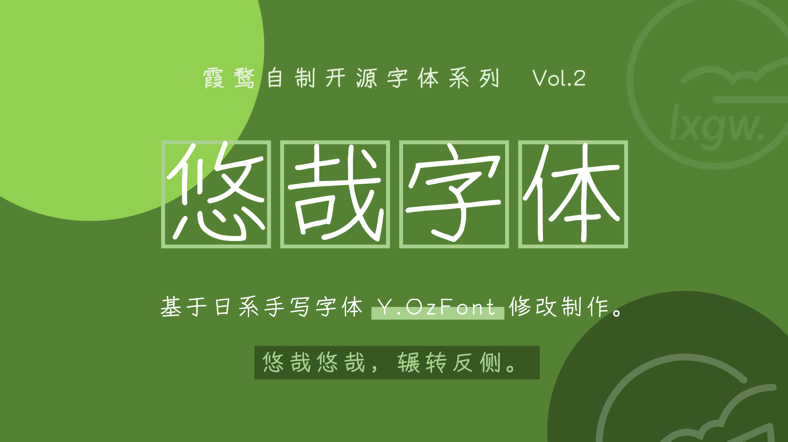
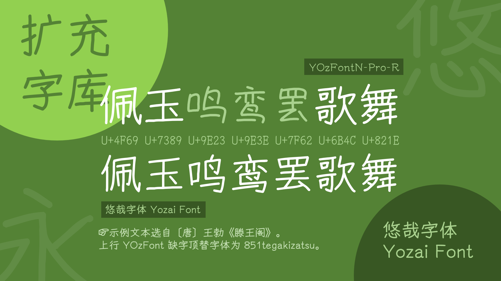
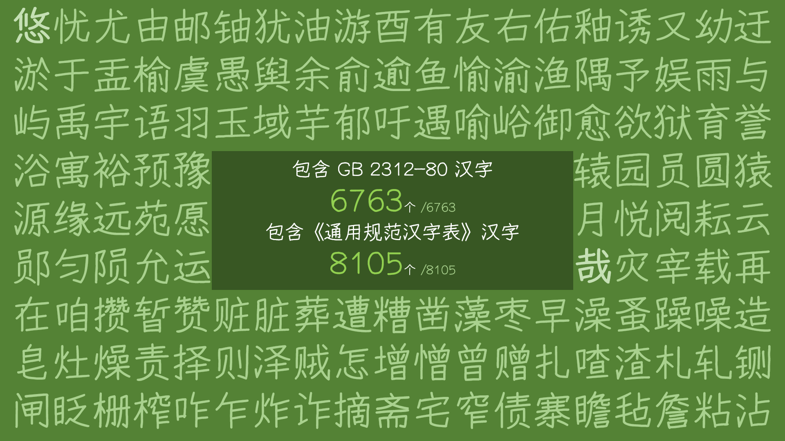
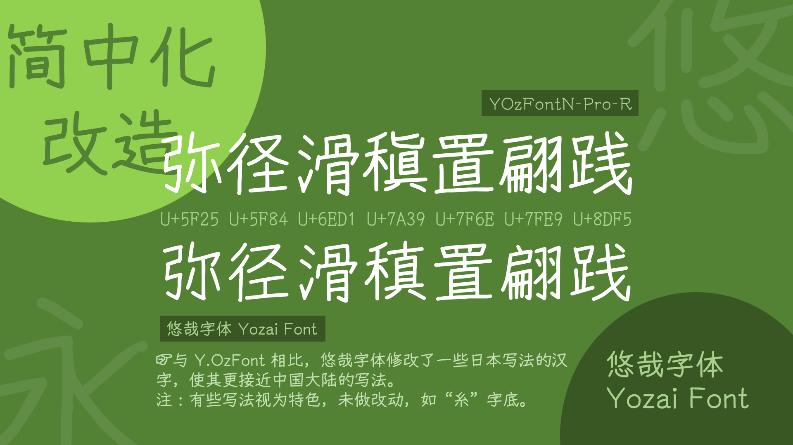
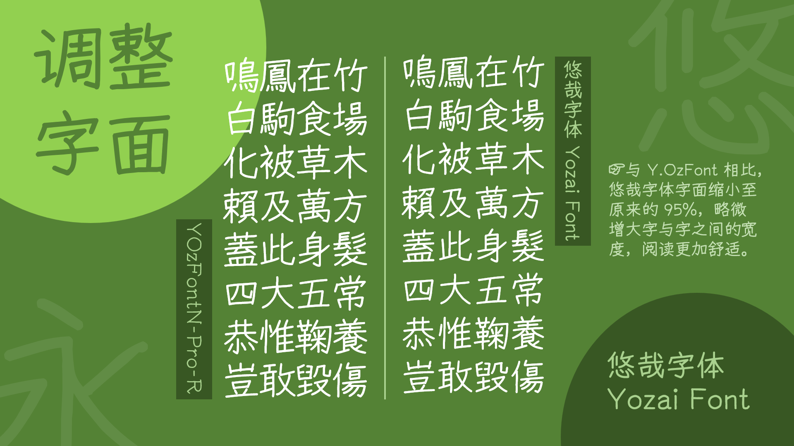
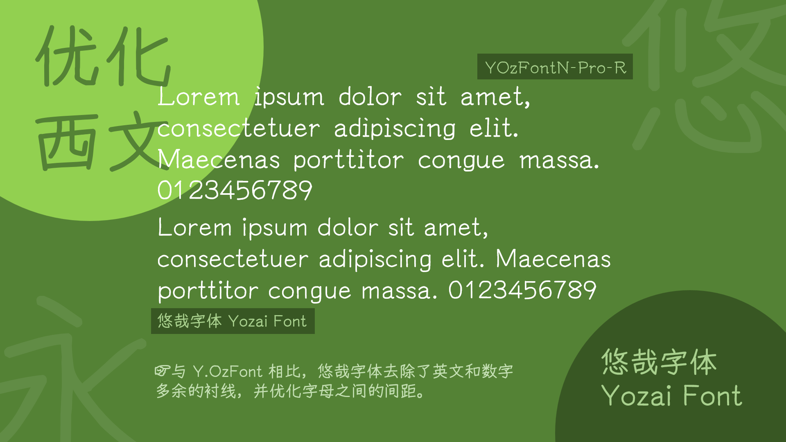
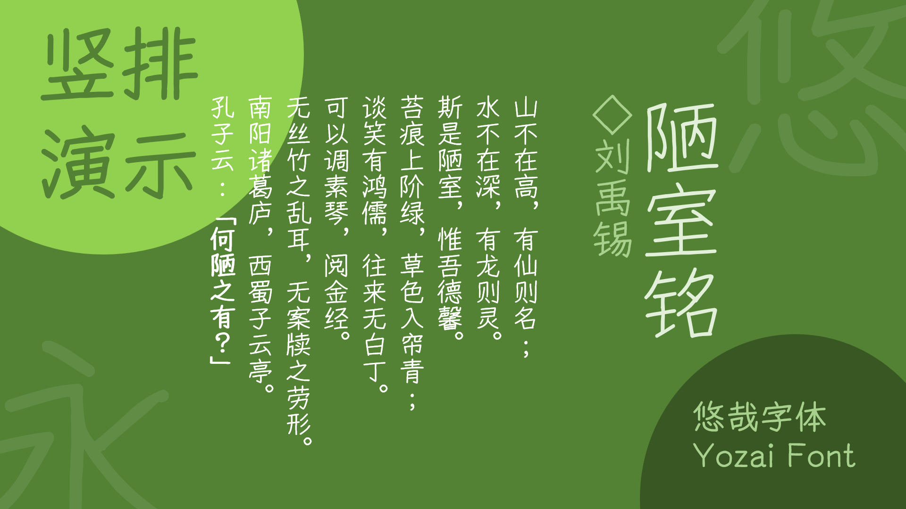
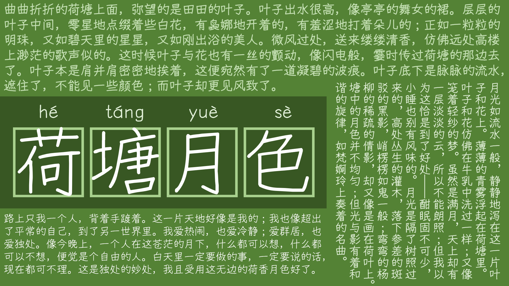
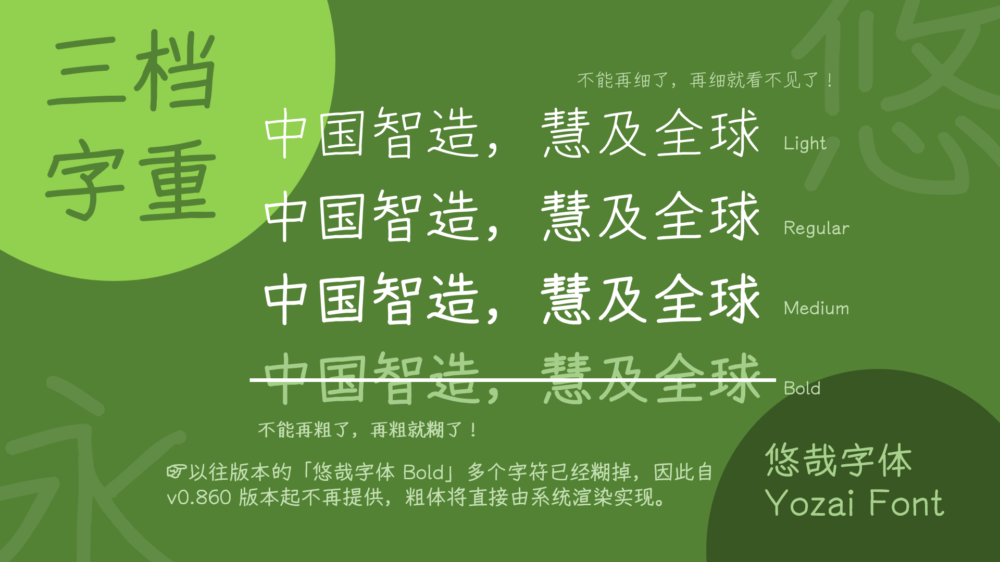

> [!CAUTION]
> 
> Many open-source fonts, including this one, have recently been resold by unauthorized merchants on platforms such as Taobao and Xiaohongshu. This violates the OFL 1.1 condition that font files may not be sold on their own. If you encounter a store selling this font, **please do not buy it!** Your payment **will not** go to the author, and you **will not** receive any updates or support.

# 悠哉字体 / Yozai Font

<a href="./README.md">简体中文</a> · <a href="./README.en.md">English</a>

A Chinese font derived from Y.OzFont.

[![猫啃网](https://shields.io/badge/%E7%8C%AB%E5%95%83%E7%BD%91-fe5e52?style=flat-square&logo=data:image/png;base64,iVBORw0KGgoAAAANSUhEUgAAACEAAAAfCAMAAABeSlSAAAAAAXNSR0IArs4c6QAAAARnQU1BAACxjwv8YQUAAAHyUExURQAAAAAA//8AAAAA//8AAAAA/wAA//8AAAAA//8AAAAA//8A//8AAAAA//8AAAAA//8AAAAA/wD///8AAAD/////AAD/////AP//AP//////AAD/////AAD/////AP///wD/////AP//AP//////AP//////AP///wD//////wD//wD/////////AP///wD//wD//wD/////AP///////////wD/////AP///wD///////////////////////////////////////////////////////////////////////////////////////////////////////////////////////////////////39/f39/f39/f39/f39/f39/f39/f39/f39/f39/f39/f39/f39/f39/f39/f39/f////39/f39/f39/f39/f39/f7+/v7+/v7+/v7+/v7+/v7+/v7+/v7+/v7+/v7+/v7+/v7+/v7+/v7+/v7+/v7+/v7+/v7+/v////7+/v7+/v7+/v7+/v7+/v7+/v7+/v7+/v7+/v7+/v7+/v7+/v7+/v7+/v7+/v7+/v7+/v7+/v7+/v7+/v7+/v7+/v////7+/v7+/v7+/v7+/v7+/v7+/v7+/v7+/v7+/v7+/v7+/v///y6UHskAAACldFJOUwADAwQEBQYGBwcICAkLCwwMDQ0NDhESEhMWFxgYGRkbHBwdHR8hIyQlJygpKSwsLS4yMjQ1Njc3ODk6PD5BQkNFRkdNUFFTVldaXF1fYGdqbnBxcnZ4eXt8gIGEhYaJio6RkpWXmJqbnJ2goqOlpqirrrCxs7S1trm7vr/BwsTHyMvMzc/Q0tPU2Nrb3N3f4uTm5+jp6+zt7vDx8vP19vf4+/z9/iyQxCoAAAAJcEhZcwAAFxEAABcRAcom8z8AAAHPSURBVDhPvZDpOxtRFIdvCJ1olaCLoqW1BF1U2tpJSlpFiK17NNE1DbGVoFVL20TRoMFUDDKS83+6Z+6tJjx9Hp+8X+b+fued88xcckLcmnl9nR8PkfVizoDPewHYcRYqVRQZr0TYfYinii0A2LReVOoDEiwrtN5txPNtMTj2B8BTH6OMGHc/A0huaduEoXg52FwwIEPY+7a1+opalV5uts/KEPp0s07aqkIj2wMv1XHmDbo0AqlTQ9rklRtoJI3DWLJ+MsxHf5mtFT7A98toCG/A9/jQBkR6/gNGzqJBLHu8O4pVrRgGiecjBJsUgeiWWPYNOtwBWk99dHlZs17KDO24Ep3nVHdMlV7ffaNRI/SEsPLkMENwYApUkUfb0K/XW0N7XTElv7GbSGZGghOTWBpno29dpT8PfWd0vxQjlRmJw8yItwPM52onAPq5MX3huIbw/n8GvzBC75+mzbJIo3iZVuFn7MIIKcIX5I7TEUZLkFb+ci6Q2G5cstrQC7CQf/4rgKtmEVfYNFwgJO0dXpAs0vbLKLXFHRrBfYmPkZQe3BpFyJXJhwxV/Tc+4fw0n+KjA+Ibhvx8CmvDjf8+IYprJsuTp+0P8ng8OQjZB5l3H1123DZyAAAAAElFTkSuQmCC)](https://www.maoken.com/freefonts/4306.html)

## Introduction
This is a handwritten-style font based on [Y.OzFont](http://yozvox.web.fc2.com). New characters were created by assembling and adjusting strokes and components from the original font *(with components drawn using a mouse when necessary)*. It now includes simplified characters whose traditional counterparts were present in the original font, all 6,763 Chinese characters in GB 2312, all 8,105 characters in the *Table of General Standard Chinese Characters*, and all 13,058 Chinese characters in BIG5. Since version 0.860, zi2zi deep learning has been used to complete the 20,992 characters in the CJK Unified Ideographs block, with a small number of Extension characters added as needed.

Compared with the original Y.OzFont, the glyph face has been reduced to 95% of its original size, the rendering of Latin characters and punctuation has been optimized, and some Chinese glyph forms have been changed to more closely follow the standard forms used in mainland China. Because the original glyphs are relatively thin, a Medium weight was added in version 0.715.

Starting with version 0.717, the font offered four weights: Light, Regular, Medium, and Bold. The Bold weight was discontinued in version 0.860.

## Changelog
[Click here](https://github.com/lxgw/yozai-font/blob/master/History.md) to view the changelog.

## Preview

## Download
1. Download the font from the [Releases](https://github.com/lxgw/yozai-font/releases) page.
2. ~~Go to the [Gitee mirror](https://gitee.com/lxgw2020/yozai-font), select “Clone/Download” → “Download ZIP,” or choose individual font files from the file list. (This option is intended for regions where GitHub downloads are unavailable and may not contain the latest version.)~~
3. Download it from [Maoken](https://www.maoken.com/freefonts/5423.html) or [Zijia](https://www.zijia.com.cn/6536.html). After this GitHub project is updated, the maintainers of those sites will be contacted so they can synchronize the update. **Note:** Other websites that list fonts free for commercial use may also host this font, but their copies may not be current.
4. [Lanzou Cloud (password: gimi)](https://www.lanzoux.com/b0cqdtnpe)

## Notes
1. This font is still in beta. Some Chinese characters still use Japanese glyph forms, ~~and the character set is not very complete.~~ ***Plan:*** *Change the forms of characters in GB 2312 to the forms used in mainland China and ~~complete all characters in the CJK Unified Ideographs block~~.*
2. I am not a professional designer and did not focus on visual aesthetics, so the result may look somewhat rough. Newly added characters may also feel slightly inconsistent with the original, and limited time prevented detailed refinement, leaving some assembled components looking rigid. Still, having them is better than not. Feedback through Issues is welcome.
3. Contributions that add or correct glyphs are welcome. You can contact the author using the details below.

## License
This font is based on the open-source [YozFont](http://yozvox.web.fc2.com) project developed and released by Y.ozVoX under the SIL Open Font License 1.1. The reserved font names are “悠哉” and “Yozai.”
This font is a derivative of the open-source [YozFont](http://yozvox.web.fc2.com) released by Y.ozVoX and is licensed under the [SIL Open Font License 1.1](https://openfontlicense.org/open-font-license-official-text/).

> [Maoken](https://www.maoken.com/) provides an unofficial [Simplified Chinese translation](https://www.maoken.com/ofl) of the SIL Open Font License 1.1 for ease of understanding. It is for reference only.

### Permissions
- Individuals and organizations may use this font freely, including for commercial purposes, without payment or separate notice to the original author. (However, I would appreciate being told. 🫶)
- This font may be freely distributed and shared. It may be installed on systems, embedded in software or apps, and bundled with any software for redistribution or sale. (Redistribution must include the complete [OFL.txt](./OFL.txt).)
- This font may be freely modified to create derivative fonts. Modified or derivative fonts must also comply with the terms and conditions of the [SIL Open Font License 1.1](https://openfontlicense.org/open-font-license-official-text/).

### Restrictions
- Under condition 1 of the OFL 1.1 “Permission and Conditions,” **font files (OTF/TTF) may not be sold on their own**.
- Under condition 5 of the OFL 1.1 “Permission and Conditions,” this font may not be distributed under any license other than the OFL 1.1, nor may it be combined in the same font file with fonts under licenses that may conflict with it (such as the GNU GPL or IPA Font License).
  
## Acknowledgements
- [Y.OzFont](http://yozvox.web.fc2.com)
- [zi2zi-pytorch](https://github.com/EuphoriaYan/zi2zi-pytorch)

## More fonts in the “LXGW” series
### “LXGW WenKai” series
- [霞鹜文楷 / LXGW WenKai](https://github.com/lxgw/LxgwWenKai) | [Lite](https://github.com/lxgw/LxgwWenKai-Lite)
- [霞鹜文楷 GB / LXGW WenKai GB](https://github.com/lxgw/LxgwWenKaiGB) | [Lite](https://github.com/lxgw/LxgwWenKaiGB-Lite)
- [霞鹜文楷 TC / LXGW WenKai TC](https://github.com/lxgw/LxgwWenKaiTC)
### “Xi, Zhi, Shang & Ming” series
- [霞鹜新晰黑 / LXGW Neo XiHei](https://github.com/lxgw/LxgwNeoXiHei)
- [霞鹜新致宋 / LXGW Neo ZhiSong](https://github.com/lxgw/LxgwNeoZhiSong)
- [霞鹜晰黑 / LXGW XiHei](https://github.com/lxgw/LxgwXiHei)
- [霞鹜致宋 / LXGW ZhiSong](https://github.com/lxgw/LxgwZhiSong)
- [霞鹜尚智黑 / LXGW Fasmart Gothic](https://github.com/lxgw/LxgwFasmartGothic) — no longer maintained
- [霞鹜铭心宋 / LXGW Heart Serif](https://github.com/lxgw/LxgwHeartSerif) — no longer maintained
### Other fonts
- [霞鹜漫黑 / LXGW Marker Gothic](https://github.com/lxgw/LxgwMarkerGothic)
- [霞鹜臻楷 / LXGW ZhenKai](https://github.com/lxgw/LxgwZhenKai)
- [小赖字体 / Xiaolai](https://github.com/lxgw/kose-font)
- **悠哉字体 / Yozai**
  

## Follow the author
- **Telegram:** [@lxgwtg](https://t.me/lxgwtg) | [Channel](https://t.me/lxgwfont)
- **WeChat official account:** 霞鹜 *(ID: lxgwshare)*
- **[Jike](https://m.okjike.com/users/2e826735-48e6-46c5-b0c2-278cb1853b54?ref=PROFILE_CARD&source=user_card&s=eyJ1IjoiNWVlMzkwZGRkNWNhNTgwMDE3NjljZjFiIiwiZCI6MX0%3D&utm_source=create_card), [SSPAI](https://sspai.com/u/ng008g7q), [Xiaohongshu](https://www.xiaohongshu.com/user/profile/64770ed70000000012035f3b), [ZCOOL](https://www.zcool.com.cn/u/26715019), [Coolapk](https://www.coolapk.com/u/633884):** @落霞孤鹜lxgw
- **Weibo:** [@孤鹜先森](https://weibo.com/6624339726)
- **Email:** calxgw2018@gmail.com srtong2006@126.com lxgw1999@qq.com

## Stargazers over time

